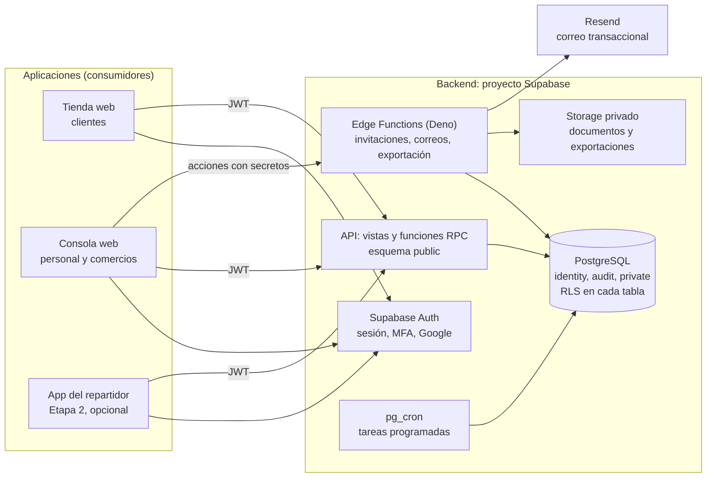

# Informe técnico del backend de la plataforma Rapitrip

Tecnología utilizada, patrón de diseño y estrategias de desarrollo

Richard Alexander Malespín Tinoco, Marlyng Elizabeth Miranda Navarrete y Moisés Abraham Zelaya Maldonado
Universidad Nacional de Ingeniería, Administración Informática, Diseño de Sistemas en Internet
Docente: MSc. Ing. Lic. Leonel Antonio Martínez Zuniga
Managua, Nicaragua, 11 de octubre de 2026

## Índice

1. [Introducción](#1-introducción)
2. [Tecnología utilizada](#2-tecnología-utilizada)
3. [Patrón de diseño que se utilizó](#3-patrón-de-diseño-que-se-utilizó)
4. [Estrategias de desarrollo](#4-estrategias-de-desarrollo)

## 1. Introducción

Rapitrip es una plataforma multi-rol con varias aplicaciones: una tienda web para el cliente, una consola web para el personal y los comercios y, más adelante, una aplicación móvil para el repartidor. Todas usan un único backend, que guarda los datos, aplica las reglas del negocio y decide quién puede hacer cada acción. Las aplicaciones solo lo consumen y no contienen reglas de negocio.

Este informe cubre la primera fase del backend (F1): identidad, roles, acceso y auditoría. Es la base de las demás fases, porque no puede existir una cuenta, un comercio o un pedido sin identidad verificada, roles y permisos. Comercios, catálogo, inventario, pedidos y cobros se agregarán como módulos nuevos sobre la misma base.

La Figura 1 muestra cómo se conectan las piezas.

Figura 1. Vista general del backend y sus consumidores

## 2. Tecnología utilizada

### 2.1 Tecnologías por capa

Tabla 1. Tecnologías del backend

| Capa | Tecnología | Uso |
|---|---|---|
| Plataforma | Supabase (plan Pro) | Base de datos, autenticación, funciones del servidor, almacenamiento y tareas programadas |
| Base de datos | PostgreSQL | Datos del dominio, transacciones y reglas de seguridad |
| Seguridad de datos | Row Level Security (RLS) | Cada consulta ve solo las filas que permiten su rol y su alcance |
| Lógica de negocio | Funciones SQL (RPC) en PL/pgSQL | Todas las escrituras y las reglas críticas, dentro de la base de datos |
| Lógica con secretos | Edge Functions en Deno y TypeScript | Llamadas a servicios externos y uso de claves del servidor |
| Identidad | Supabase Auth | Registro, inicio de sesión, tokens JWT, segundo factor (TOTP) y acceso con Google |
| Tareas programadas | pg_cron, pg_net y Vault | Sincronizar inicios de sesión, detectar incidentes, marcar cuentas inactivas y enviar correos |
| Archivos | Supabase Storage | Documentos de repartidores y archivos de exportación, en depósitos privados |
| Correo | Resend (SMTP y API) | Confirmación de correo, invitaciones, recuperación de contraseña y avisos |
| Protección contra abuso | Cloudflare Turnstile (CAPTCHA) | Frena la fuerza bruta en el inicio de sesión de la consola |
| Pruebas | pgTAP, Deno test, Vitest | Base de datos, funciones del servidor y paquetes compartidos |
| Lenguajes | SQL / PL/pgSQL y TypeScript | SQL para las reglas; TypeScript para funciones, validaciones y scripts |
| Validación | zod | Repite en las interfaces las reglas de la base para avisar antes de llamar al servidor |
| Repositorio | Monorepo con pnpm, Git y GitHub | Backend y paquetes comunes en un solo repositorio versionado |
| Herramientas | Supabase CLI y Docker | Entorno local igual al de producción y aplicación de migraciones |
| Integración continua | GitHub Actions | Corre todas las pruebas en cada cambio |

### 2.2 Supabase como backend central

El backend se construye sobre Supabase y no sobre un servidor propio con Node, Express o NestJS. Las razones:

- Hay menos que operar. Para un equipo de tres personas y 25 a 30 pedidos al mes, un servicio administrado evita mantener servidores, balanceadores y parches.
- La seguridad vive junto a los datos. Con RLS y funciones en la base, las reglas se aplican igual sin importar qué aplicación llame, y un canal nuevo (la app del repartidor o una app móvil del cliente) no obliga a reescribir permisos ni estados.
- Las transacciones son atómicas. Una acción y su registro de auditoría se confirman o se revierten juntos, algo que un servidor aparte tendría que coordinar a mano.
- Se usa un solo lenguaje de aplicación: TypeScript en funciones, validaciones y scripts, y SQL para las reglas.

El costo es que la lógica queda en PL/pgSQL y en Edge Functions, y se prueba con pgTAP y no con las herramientas habituales de un servidor. El diseño lo compensa exigiendo una prueba por cada regla de acceso.

### 2.3 Supabase Auth en lugar de Clerk

La propuesta inicial usaba Clerk. Se cambió a Supabase Auth tras comparar ambas:

| Aspecto | Supabase Auth | Clerk |
|---|---|---|
| Integración con la base | Nativa: `auth.uid()` funciona dentro de las políticas RLS | Requiere integración de terceros y validación del token |
| Segundo factor (TOTP) | Incluido | Requiere el plan Pro |
| Piezas externas | Ninguna adicional | Un proveedor más |
| Datos de los usuarios | En la base de Rapitrip | En el servicio externo |
| Pantallas de inicio de sesión | Se construyen en las aplicaciones | Componentes listos |

Con Supabase Auth el segundo factor obligatorio pasa de la fase F7 a la F1 sin costo adicional, y los roles se guardan y verifican en una sola base.

### 2.4 Límites de la plataforma

La documentación oficial de Supabase confirma cuatro límites, y el diseño ya los contempla:

1. Los hooks de verificación de contraseña y de MFA son de los planes Teams y Enterprise. En el plan Pro no hay bloqueo exacto de cuenta por intentos fallidos. Se usan límites de tasa, CAPTCHA, segundo factor obligatorio e incidente automático.
2. Los enlaces de correo de Supabase vencen en 24 horas como máximo. Las invitaciones de 4 días usan un token propio.
3. El cierre por inactividad de Supabase se evalúa al renovar el token, y una pestaña abierta se renueva sola. Por eso se agrega una capa propia que registra la actividad real de la persona.
4. Un inicio con Google más segundo factor da el nivel de seguridad `aal2` sin el método `password`. La base distingue ese caso y no lo acepta en las funciones de la consola.

## 3. Patrón de diseño que se utilizó

### 3.1 Monolito modular centrado en la base de datos

El backend es un monolito modular: una sola unidad desplegable dividida en módulos con responsabilidades propias. No se usan microservicios, porque un equipo pequeño y un solo PostgreSQL no los justifican.

Cada módulo es un esquema de PostgreSQL con sus tablas, políticas y funciones.

Tabla 2. Esquemas del backend

| Esquema | Responsabilidad | Acceso desde fuera |
|---|---|---|
| `identity` | Perfiles, roles, invitaciones, solicitudes de comercio y fichas de repartidores | Solo por vistas y RPC |
| `audit` | Auditoría, inicios de sesión e incidentes de TI | Solo por RPC; sin escritura directa |
| `private` | Funciones de seguridad y auxiliares, cola de correos | Ninguno |
| `public` | Vistas de lectura y funciones RPC | Aplicaciones, con permisos explícitos |

Los dominios futuros (comercios, catálogo, inventario, pedidos) se agregan como esquemas nuevos sin modificar los existentes.

### 3.2 Patrones aplicados

Tabla 3. Patrones de diseño y su aplicación

| Patrón | Aplicación en el backend |
|---|---|
| Control de acceso por roles con alcance (RBAC) | Seis roles. El rol `comercio` queda limitado a su comercio. La matriz de quién gestiona a quién es una tabla de datos, `private.role_management`, y no código repetido |
| Defensa en profundidad y Zero Trust | Ninguna aplicación es confiable. Cada acción se valida en la base: rol activo, alcance, sesión de consola y, cuando corresponde, segundo factor reciente |
| Denegado por defecto | Toda tabla nace con RLS activo y sin políticas, y ninguna función nueva es ejecutable hasta que se concede |
| API por funciones (fachada) | Las aplicaciones no escriben en tablas. Llaman funciones RPC de nombre estable que validan y ejecutan |
| Separación de lectura y escritura (CQRS ligero) | Las lecturas pasan por vistas con `security_invoker` y RLS; las escrituras, solo por RPC |
| Funciones con privilegios elevados encapsuladas | Las funciones `SECURITY DEFINER` viven en un esquema no expuesto, fijan `search_path` y toman la identidad de `auth.uid()` en lugar de recibirla como parámetro |
| Registro de auditoría de solo inserción (event log) | Una función única escribe la auditoría dentro de la transacción de la acción. Un trigger impide modificar o borrar, incluso al propietario |
| Minimización de datos | La auditoría guarda ids y nombres de campos, nunca valores personales. Los datos personales viven en una tabla aparte, `profile_pii` |
| Transactional Outbox | Los correos que nacen en la base se encolan en la misma transacción y una función los envía después, con reintentos y sin duplicados |
| Token de un solo uso con hash | Las invitaciones guardan solo el hash SHA-256 del token, que se consume una vez |
| Pseudonimización | Al anonimizar una cuenta se borran los datos personales y el acceso, y el perfil queda como identificador anónimo para pedidos y cobros |
| Contrato por tipos generados | Los tipos de TypeScript se generan desde el esquema real y son el contrato con las aplicaciones. La integración continua falla si quedan desactualizados |

### 3.3 Ejemplo: suspender el rol de un cajero

1. La consola llama a la función `suspend_role` y no escribe en ninguna tabla.
2. La función exige una sesión de consola válida: contraseña, segundo factor y actividad en los últimos 15 minutos.
3. Comprueba en la matriz que ese administrador puede gestionar el rol cajero, que no es su propio rol y que el motivo está completo.
4. Cambia el estado del rol y, en la misma transacción, escribe el evento de auditoría con actor, acción, objetivo y motivo.
5. Si algo falla, no queda nada a medias.

Una prueba automática cubre cada paso.

### 3.4 Roles verificados en la base y no en el token

Las políticas y funciones consultan siempre la tabla de roles. El token de sesión lleva además una lista de roles (`app_roles`), pero las aplicaciones la usan solo para decidir qué menú mostrar. Un token con roles viejos nunca concede acceso. Por eso suspender o revocar un rol tiene efecto inmediato, algo que un diseño basado en el token no garantiza hasta que este se renueve.

## 4. Estrategias de desarrollo

### 4.1 Metodología

El desarrollo sigue Scrum adaptado a tres personas, como define la propuesta tecnológica: sprints de dos semanas con 180 horas de capacidad (3 integrantes por 30 horas durante dos semanas) y una revisión con un administrador de Rapitrip al cierre de cada sprint. Una tarea está terminada cuando otro integrante revisó el código, las pruebas automáticas pasan y los permisos se verificaron con la matriz de pruebas.

### 4.2 Secuencia de construcción

El backend va un paso adelante de la interfaz. Se trabaja por rebanadas verticales:

1. Se construye primero el backend completo de la fase F1 (identidad, roles y auditoría) con sus pruebas, porque todo lo demás depende de él.
2. Después se avanza módulo por módulo, con el backend de cada uno un sprint antes que su pantalla.
3. El contrato entre ambos son los tipos generados y las funciones RPC de nombre estable. Una pantalla nunca depende de una tabla que aún no existe.

Con tres personas, una puede preparar el backend del módulo siguiente mientras las otras dos hacen la interfaz del anterior.

### 4.3 Proceso de diseño

Antes de escribir código se elaboran tres documentos, cada uno aprobado por el equipo.

Tabla 4. Documentos previos al código

| Documento | Contenido |
|---|---|
| Diseño (spec) | Decisiones de arquitectura y seguridad, tomadas una por una con sus alternativas |
| Plan de implementación | 22 tareas ordenadas, con archivos, interfaces y código completo |
| Manual de producción | Procedimiento repetible para crear el entorno real |

Cada decisión se tomó comparando opciones con sus ventajas y desventajas, por ejemplo Supabase Auth frente a Clerk, o roles en el token frente a roles consultados en la base, y se registró con su motivo.

### 4.4 Desarrollo guiado por pruebas

Cada tarea sigue el mismo ciclo: escribir la prueba, verla fallar, implementar lo mínimo, verla pasar y registrar el cambio.

Tabla 5. Cobertura de pruebas

| Qué se prueba | Herramienta |
|---|---|
| Matriz de permisos: cada tabla, vista y función por cada rol, incluido el anónimo | pgTAP |
| Matriz de gestión de roles, en positivo y en negativo | pgTAP |
| Restricciones de la base: un comercio por cuenta y rol superadmin solo por código | pgTAP |
| Auditoría inmutable: modificar o borrar falla para todos los roles | pgTAP |
| Sesión de consola con tokens simulados y con tokens reales de Auth | pgTAP y scripts de verificación |
| Funciones del servidor: tokens, plantillas y CSV | Deno test |
| Validaciones compartidas | Vitest |

Una prueba de regresión hace fallar el cambio si aparece una tabla sin RLS, una función ejecutable por el rol anónimo o una función con privilegios elevados sin `search_path` fijo.

### 4.5 Seguridad desde el diseño

- Mínimo privilegio: cada función se concede una por una, y las de servidor solo las ejecuta el rol interno.
- Datos sensibles: el documento de identidad del repartidor, los datos personales completos de un cliente y la consulta de la auditoría ajena se leen solo por funciones que registran la lectura.
- Exportaciones: las hacen solo el administrador y el superadministrador, con motivo, segundo factor de los últimos 5 minutos, archivo cifrado y enlace de 15 minutos.
- Sesión: segundo factor obligatorio en todos los roles de consola y cierre por inactividad en dos capas, la de Supabase y una propia que registra la actividad real.
- Ley 787: anonimización de cuentas inactivas (12 meses, con confirmación del administrador), atención de solicitudes de los titulares y auditoría sin datos personales.

### 4.6 Control de cambios y entornos

- Todo cambio de esquema es una migración SQL con nombre fijo. Es la única fuente de verdad y solo avanza.
- Hay dos entornos: local, igual al de producción, con la CLI de Supabase y Docker, y un proyecto de producción. El entorno de staging queda para una planificación posterior, cuando haya clientes reales.
- En cada cambio la integración continua levanta Supabase, aplica las migraciones, corre las pruebas, revisa la base con el lint de Supabase y verifica que los tipos generados estén al día.
- Se hace un commit por tarea completada, con su prueba incluida.

### 4.7 Verificación de comportamientos inciertos

Cuando una decisión dependía de un comportamiento de la plataforma que no bastaba con leer, se verificó y se anotó el resultado. Se confirmó en la documentación oficial que el hook de verificación de contraseña no está en el plan Pro, y el diseño se ajustó antes de escribir código. Quedan cuatro pruebas con la autenticación real, con resultado escrito:

1. Si los intentos de inicio de sesión fallidos aparecen en el registro de Auth.
2. Si una pestaña inactiva sigue renovando el token.
3. Cómo viaja el método de autenticación dentro del token.
4. Cómo se vinculan las identidades de Google con las cuentas existentes.

### 4.8 Operación y continuidad

- Respaldo diario con retención de 7 días (plan Pro) y prueba trimestral de restauración en un entorno separado, con fecha y resultado registrados.
- Pérdida máxima aceptable de un día y tiempo de recuperación de 24 horas.
- Registro de incidentes de TI en la consola, con incidentes automáticos y alerta por correo a los de gravedad alta.
- Manual de producción con las pruebas de humo que se corren al poner el sistema en marcha.

### 4.9 Fases del proyecto

El backend de este informe es la fase F1. El resto sigue la propuesta tecnológica.

Tabla 6. Fases y backend

| Fase | Alcance | Backend |
|---|---|---|
| F1 | Identidad, roles, permisos, auditoría y consola administrativa | Este informe |
| F2 | Catálogo por tienda, inventario y horarios | Módulo siguiente |
| F3 | Motor de pedidos, cobros con Tilopay, caja y venta | Después de F2 |
| F4 | Tienda web del cliente y puesta en marcha de la Etapa 1 | Interfaz |
| F5 a F7 | Aplicación del repartidor (opcional), tablero de operaciones y liquidaciones | Etapa 2 |
