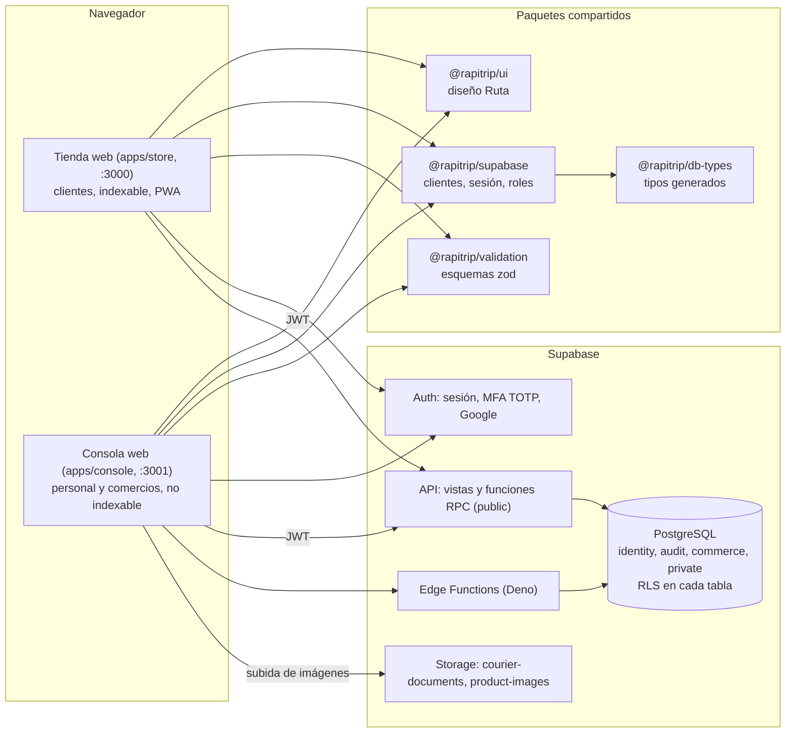
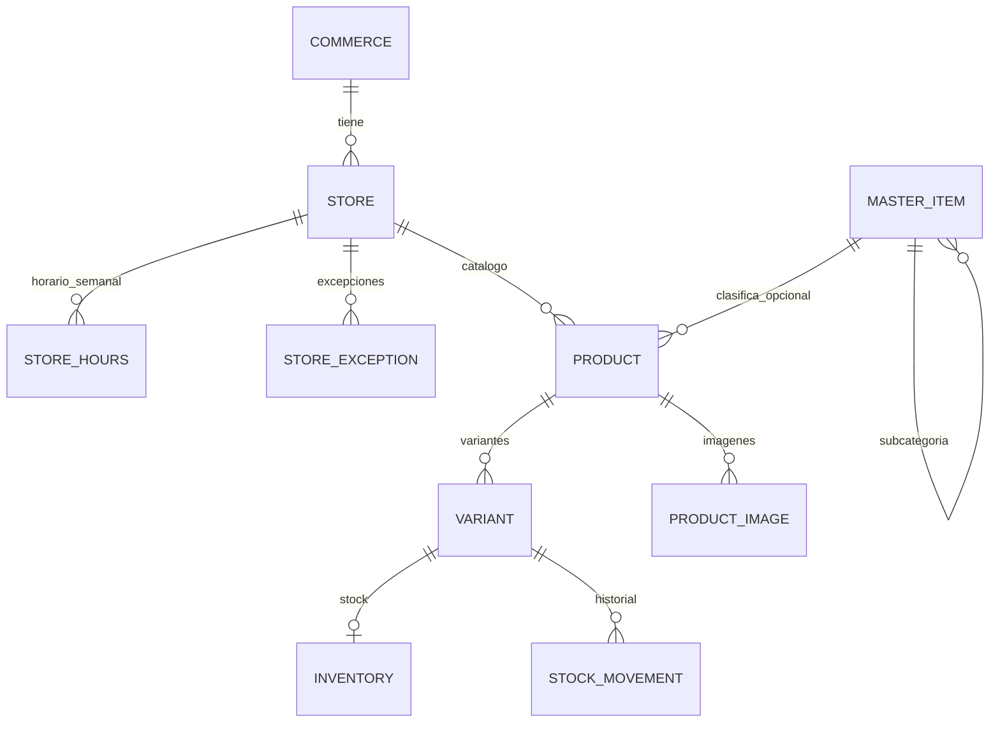

# Informe del frontend de Rapitrip: fases 1 a 7

Managua, Nicaragua, 17 de octubre de 2026
Estado del documento: versión 1, consolidada desde el código, la base de datos viva, los informes anteriores y el historial del repositorio.

> **Cómo leer este documento.** Reúne en un solo lugar todo lo que se decidió, construyó y verificó en el frontend, y lo que falta por construir. Las fases 1 y 2 están **construidas y verificadas**; las fases 3 a 7 están **planificadas** y su alcance se describe como propuesta, sin diseño aprobado. Cada afirmación sobre lo construido se contrastó con el código (`apps/`, `packages/`, `supabase/`, `e2e/`); ante una diferencia entre este documento y el código, manda el código.

**Documentos relacionados.** Este informe consolida y reemplaza como lectura de entrada a: `docs/informe/2026-10-16-frontend-fundacion-design.md` (diseño y cierre de la Fase 1), `docs/informe/Informe_Tecnico_Frontend_Rapitrip.md` (propuesta técnica original; su paleta quedó superada), `docs/informe/Informe_Backend_Rapitrip.md` (backend F1), `docs/backend-referencia.md` (referencia técnica del backend, fases 1 y 2) y `docs/fase-1-puesta-en-marcha.md` (guía de puesta en marcha).

---

## 1. Resumen ejecutivo

Rapitrip es una plataforma de comercio electrónico y gestión logística para una microempresa de Nicaragua. El frontend se compone de **dos aplicaciones web** (una consola para el personal y los comercios, y una tienda pública para los clientes) y **cuatro paquetes compartidos**, sobre un backend en Supabase que decide todos los permisos.

Tabla 1. Estado de las fases del frontend

| Fase | Alcance | Estado | Verificación |
|---|---|---|---|
| F1 | Cimientos: monorepo, sistema de diseño, acceso, administración de identidad, tienda con cuenta y solicitud de comercio | **Construida** | 297 pruebas de base de datos al cierre, accesibilidad en CI, flujos con backend |
| F2 | Área de comercio: tiendas, horarios, catálogo maestro, productos, variantes, imágenes e inventario; gestión de comercios en administración | **Construida** | pgTAP completo (392), 4 E2E de comercio, 35 de accesibilidad |
| F3 | Pedidos, cobros con tarjeta, caja y venta, coordinación | **Construida** (falta la pantalla de pago de la tienda, que es F4): backend de pedidos (25), pagos con Stripe (26), venta de mostrador y turnos de caja (27), y las pantallas de pedidos del comercio, de caja, de coordinación y de administración construidos y probados; y un E2E de punta a punta con el CI ampliado; el flujo de pago de la tienda pasa a F4 | pgTAP `250` y `260`, 3 pruebas de Deno y 2 E2E reales contra Stripe en modo prueba |
| F4 | Tienda pública con catálogo, carrito y checkout; puesta en marcha de la Etapa 1 | Planificada | Las bases (disponibilidad e imágenes públicas) ya existen |
| F5 | Aplicación del repartidor (opcional) | Planificada | Sin diseño aprobado |
| F6 | Tablero de operaciones en vivo y excepciones | Planificada | Sin diseño aprobado |
| F7 | Liquidaciones | Planificada | Sin diseño aprobado |

**Cifras al 17 de octubre de 2026** (verificadas en esta fecha): 25 pantallas en la consola y 9 en la tienda; 24 migraciones; 6 Edge Functions; 392 pruebas pgTAP en 24 archivos; 109 pruebas unitarias y de componentes; 55 pruebas de extremo a extremo (35 sin backend y 20 con backend); 3 trabajos en el CI.

**Lo que bloquea salir a producción** (no es código): revisión legal de los textos (Ley 787), credenciales reales de Google, Cloudflare y Resend, y el despliegue en Vercel con dominio propio. Ver sección 13.

---

## 2. Contexto del proyecto

### 2.1 Qué es Rapitrip

Una plataforma que conecta a clientes con comercios afiliados y organiza la entrega. La Etapa 1 cubre identidad, comercios, catálogo, pedidos, cobros y la tienda web; la Etapa 2 agrega la aplicación del repartidor, el tablero de operaciones y las liquidaciones.

Tabla 2. Fases del proyecto y del backend (de la propuesta tecnológica)

| Fase | Alcance | Etapa |
|---|---|---|
| F1 | Identidad, roles, permisos, auditoría y consola administrativa | 1 |
| F2 | Catálogo por tienda, inventario y horarios | 1 |
| F3 | Motor de pedidos, cobros con Tilopay, caja y venta | 1 |
| F4 | Tienda web del cliente y puesta en marcha de la Etapa 1 | 1 |
| F5 a F7 | Aplicación del repartidor (opcional), tablero de operaciones y liquidaciones | 2 |

### 2.2 Quién usa qué

Tabla 3. Personas, roles y dónde trabajan

| Persona | Rol en la base de datos | Aplicación y área | Ruta de inicio |
|---|---|---|---|
| Director | `superadmin` | Consola, `admin` (incluye datos personales) | `/admin` |
| Administrador | `admin` | Consola, `admin` | `/admin` |
| Encargado de ventas (caja) | `cajero` | Consola, `caja` | `/caja` |
| Encargado de ventas (coordinación) | `coordinador` | Consola, `coordinacion` | `/coordinacion` |
| Comercio afiliado | `comercio` | Consola, `comercio` | `/comercio` |
| Cliente | `cliente` | Tienda | `/` |

Los clientes llegan sobre todo por enlaces compartidos en WhatsApp, por eso la tienda se diseña **móvil primero**. La consola se diseña para computador (barra lateral de 264 px, contenido de hasta 1176 px).

### 2.3 Decisiones de producto confirmadas

- Dos aplicaciones separadas en un mismo repositorio, con una sola consola para todos los roles de consola y una carpeta por área sin importaciones entre ellas.
- Identidad con Supabase Auth (no Clerk). Segundo factor TOTP obligatorio para todos los roles de consola. Google solo para clientes.
- `cajero` y `coordinador` tienen áreas separadas (`/caja` y `/coordinacion`).
- `superadmin` solo se otorga por código; la interfaz no lo permite.
- Rapitrip opera en Nicaragua: zona horaria `America/Managua` (UTC−6, sin horario de verano) y moneda por defecto el córdoba (`NIO`, configurable con `NEXT_PUBLIC_CURRENCY`).
- Cierre por inactividad de la consola: **15 minutos**, igual en la interfaz, en `supabase/config.toml` y en la ventana de actividad de la base de datos.
- Sesión del cliente: hasta 24 horas.
- Catálogo maestro **orientativo**: no es obligatorio para publicar un producto.

---

## 3. Arquitectura

### 3.1 Vista general

Figura 1. Piezas del sistema y quién las consume



### 3.2 Estructura del repositorio

```
apps/
  console/   Next.js, puerto 3001
    src/app/
      (acceso)/       login, mfa, aceptar-invitacion, sesion-expirada, sin-acceso
      admin/          inicio, usuarios, solicitudes, comercios (+ detalle), catalogo, repartidores,
                      auditoria, accesos, incidentes, datos-personales
      caja/           inicio del área (resto: F3)
      coordinacion/   inicio del área (resto: F3 y F6)
      comercio/       inicio, tiendas (+ detalle), catalogo (+ editor), inventario
      cuenta/         mi cuenta (común a todos los roles de consola)
    src/lib/          guardias, navegación por área, formatos, tiendas, dinero, etiquetas de auditoría
  store/     Next.js, puerto 3000
    src/app/
      (acceso)/       ingresar, registro, recuperar, recuperar/nueva
      (tienda)/       inicio, perfil, vende, terminos, privacidad
      auth/callback   cierra el intercambio PKCE (Google, confirmación de correo, recuperación)
packages/
  ui/          tokens, componentes, movimiento y portada de marca
  supabase/    clientes (navegador y servidor), sesión, roles y decisión de acceso
  validation/  esquemas zod compartidos
  db-types/    tipos generados de la base (pnpm db:types)
e2e/           Playwright y axe (workspace propio)
supabase/      migraciones 1 a 24, pruebas pgTAP, Edge Functions, semillas y plantillas de correo
docs/          informes y guías
```

**Reglas de dependencia.** Las apps dependen de los paquetes; los paquetes no dependen de las apps. Las carpetas por área de la consola no se importan entre sí. `packages/ui` no conoce Supabase. Una ruta existe una sola vez: si una pantalla pasa a otro grupo de rutas, la carpeta anterior se elimina en el mismo cambio.

### 3.3 Pila técnica

Tabla 4. Tecnologías del frontend

| Capa | Elección | Nota |
|---|---|---|
| Framework | Next.js 16 (App Router, Turbopack), React 19, TypeScript estricto | Hereda `tsconfig.base.json` (`strict`, `noUncheckedIndexedAccess`) |
| Estilos | Tailwind CSS 3.4 con el preset de `packages/ui` | Tokens como variables CSS |
| Componentes | Propios, con `class-variance-authority`, `clsx`, `tailwind-merge` y `lucide-react` | Sustituyen a shadcn/ui del diseño original |
| Sesión | `@supabase/ssr` con cookies de nombre propio por app | `proxy.ts` renueva la sesión y redirige por comodidad |
| Validación | `@rapitrip/validation` (zod 3) | Mismos esquemas en cliente y servidor |
| Tipos | `@rapitrip/db-types` | Regenerados con `pnpm db:types`; el CI verifica que estén al día |
| CAPTCHA | Cloudflare Turnstile | Ingreso, registro y recuperación |
| Pruebas | Vitest 2, Playwright 1.56 y axe | Ver sección 10 |
| Fuentes | Bricolage Grotesque (títulos) y Plus Jakarta Sans (texto) | Con `next/font` |
| Gestor de paquetes | pnpm 11 | Política de antigüedad mínima de paquetes |

**Datos en el cliente.** El diseño original preveía TanStack Query y Table. No se usaron: los datos llegan desde el servidor (componentes de servidor y acciones de servidor) y las tablas son propias (`DataTable`). Conviene reevaluarlo si alguna fase futura necesita estado de cliente complejo (por ejemplo, el tablero en vivo de F6).

### 3.4 Patrón de pantalla de la consola

Todas las pantallas con datos siguen el mismo patrón, que las fases futuras deben respetar:

1. La página (componente de servidor) llama a `requireConsoleAccess(area)`, que vuelve a leer sesión y rol del servidor.
2. Lee **vistas** de `public` con el cliente de servidor (respetan RLS) y normaliza las filas a tipos de la pantalla.
3. Pasa los datos y las **acciones de servidor** a un componente de cliente (`*-workspace.tsx`, `*-editor.tsx`).
4. Cada acción valida con un esquema de `@rapitrip/validation`, vuelve a exigir el acceso, llama a **una función RPC** y devuelve `{ ok: true } | { ok: false, error }`; los errores de la base de datos con códigos `42501`, `22023`, `P0002` y `23505` se muestran con su mensaje, el resto como un aviso genérico.
5. Tras escribir se invalida la caché de las rutas afectadas y el cliente refresca.
6. Los estados vacío, de carga y de error son parte de la pantalla, no un añadido.

---

## 4. Sistema de diseño "Ruta"

### 4.1 Identidad

La identidad sale del logo: **verde esmeralda como color principal y azul marino como secundario**, sobre un fondo claro y fresco. Un rediseño del 17 de octubre de 2026 corrigió una primera versión en la que dominaba el azul: ahora el verde es siempre el tono principal (acciones, enlaces, estado activo, panel de marca) y el azul queda como acento. Los nombres de los tokens se conservaron de la primera versión (`selva` es la superficie oscura y `hoja` la acción principal) para no tocar cada componente.

Tabla 5. Tokens (`packages/ui/src/tokens.css`, preset en `tailwind-preset.cjs`)

| Token | Valor | Uso |
|---|---|---|
| `selva` | `#06362A` | Superficie oscura (barra lateral, panel de marca) |
| `selva-panel` | `#0A4A39` | Paneles sobre `selva` |
| `hoja` | `#0B7A57` | Acción principal, enlaces, estado activo |
| `esmeralda` | `#24C08E` | Color de marca |
| `marino` | `#0C4E67` | Color secundario de marca |
| `exito` | `#0B6B4B` | Estados correctos |
| `menta`, `menta-borde`, `bruma` | `#DCF6EC`, `#A9E4CD`, `#B4E6D2` | Fondos suaves e insignias |
| `crema`, `papel` | `#F4F8F5`, `#FCFDFB` | Fondo de página y tarjetas |
| `borde`, `borde-campo` | `#E2EBE5`, `#CCD8D0` | Bordes de tarjeta y de campo |
| `tinta`, `tinta-suave` | `#14231D`, `#55645D` | Texto y texto secundario |
| `calido`, `durazno`, `lavanda`, `rosa` | `#FFF4E6`, `#FFE9D6`, `#E3E8FF`, `#FDE7E4` | Fondos de insignias neutras o de aviso |
| `rojo`, `naranja`, `durazno-texto` | `#A53B3B`, `#D96C2A`, `#9E4300` | Errores y advertencias |

El blanco sobre `hoja` supera 5:1 y `bruma` sobre `selva` supera 9:1, por encima del mínimo de 4.5:1 para texto normal. La propuesta original usaba Mango (`#F59E2B`) como acento; se descartó porque el logo no lo tiene.

### 4.2 Tipografía

Bricolage Grotesque para títulos (`--font-titulo`) y Plus Jakarta Sans para el texto (`--font-texto`), cargadas con `next/font/google`. El lema "Seguridad y Confianza" y el nombre "Rapitrip" sobre fondo oscuro se muestran como **texto vivo** (componentes `Lema` y `Logo`), no como imágenes: son nítidos a cualquier tamaño y legibles para lectores de pantalla. Solo el emblema y el logo completo siguen siendo imágenes.

### 4.3 Componentes (`packages/ui`)

Alerta, avatar, insignia (y `Eyebrow`), botón (con `ButtonIsland`), tarjeta de doble bisel (`Card`, `CardHeader`), indicador (`KpiCard`), campo de texto, selección y área de texto, campo de código de seis dígitos, diálogo (`<dialog>` nativo), estado vacío, tabla y tabla de datos, pestañas en píldora (`pillStyles`), logo, lema, aparición progresiva (`Reveal`), introducción de marca (`IntroSplash`), widget de Turnstile y la estructura de las pantallas de acceso (`AuthLayout`).

- **Tarjeta de doble bisel:** una bandeja exterior con borde de un pelo y, dentro, el núcleo con su propio reflejo superior y radio concéntrico.
- **Botón:** píldora; al pulsar se hunde levemente; el ícono trasero va en su propio círculo (`ButtonIsland`) que se desplaza en diagonal al pasar el cursor.
- **Tablas:** el contenedor con desplazamiento horizontal es una región enfocable por teclado (WCAG 2.1.1).

### 4.4 Movimiento

Todo se anima con `transform` y `opacity` y con una sola curva (`cubic-bezier(0.32, 0.72, 0, 1)`, clase `ease-fluido`); nada usa `linear` ni `ease-in-out`. La entrada de cada página usa un desenfoque que se resuelve; la introducción de marca se reproduce una vez por sesión. Con "reducir movimiento" no hay animaciones ni introducción. Las capas (`z-index`) son las del sistema: navegación, cajón, grano e introducción.

### 4.5 Reglas de uso

- Ningún componente usa un color fuera de los tokens.
- Un solo botón primario por vista.
- Contraste mínimo 4.5:1, foco visible, objetivos táctiles de 44 px en la tienda y etiquetas siempre visibles en los formularios.
- Un elemento con `aria-label` debe incluir en su nombre accesible el texto que se ve (WCAG 2.5.3).
- Redacción en español, minúsculas después de la primera palabra, verbo al inicio en los botones y sin signos de exclamación en el sistema.
- Íconos de trazo fino (`.lucide { stroke-width: 1.5 }`).

### 4.6 Densidad y adaptación

Consola: barra lateral de 264 px, contenido de hasta 1176 px; por debajo de 1024 px la barra se oculta tras un menú; tablas de unos 40 px de fila. Tienda: móvil primero, puntos de corte 640, 768 y 1024 px, navegación flotante en "isla" que en móvil se transforma en un cajón de pantalla completa con los enlaces en cascada. El panel de marca del acceso se ajusta a la altura para que todo quepa en un portátil.

---

## 5. Acceso, roles y seguridad

### 5.1 Decisión de acceso

El token incluye los roles en el claim `app_roles` (hook `custom_access_token`). La decisión vive en `packages/supabase/src/roles.ts`: prioridad entre roles (`superadmin`, `admin`, `coordinador`, `cajero`, `comercio`, `cliente`), segundo factor obligatorio para los roles de consola y las redirecciones:

- sin sesión → `/login`;
- contraseña sin segundo factor → `/mfa`;
- cuenta sin rol, suspendida o revocada → `/sin-acceso`;
- sesión vencida por inactividad → `/sesion-expirada`.

Un comercio **suspendido** deja a su cuenta sin rol efectivo (F2). Una sesión de Google no cumple `has_strong_session` (exige contraseña en la sesión, segundo factor y actividad reciente), así que no habilita acciones privilegiadas.

### 5.2 Sesión de consola

Contraseña, segundo factor (aal2) y actividad en los últimos 15 minutos. La consola envía un **latido** (`touch_session`) inmediatamente después de verificar el segundo factor, al montarse y cada minuto mientras hay interacción; a los 15 minutos sin interacción cierra la sesión. El token de acceso dura 5 minutos y se renueva solo; se verificó que la renovación mantiene `aal2` (ver 10.4).

### 5.3 Principios de seguridad

- **La interfaz oculta; la base de datos decide.** Ninguna acción depende de que un botón esté escondido.
- Cada carga protegida y cada acción de servidor vuelven a obtener sesión y rol; `proxy.ts` solo redirige por comodidad.
- Cookies de `@supabase/ssr` con nombre propio por app (`rapitrip-console-auth`, `rapitrip-store-auth`); el token no se guarda en `localStorage`. Las dos apps pueden tener sesión a la vez en el mismo navegador sin cerrarse entre sí.
- Variables públicas: solo la URL de Supabase, la clave anónima, la clave pública de Turnstile y valores de configuración. La clave de servicio no se usa en el navegador.
- Mensajes de error genéricos hacia el usuario; el detalle queda en el registro del servidor.
- Cabeceras en `next.config.mjs` de ambas apps: Content-Security-Policy (solo Supabase y `challenges.cloudflare.com`; incluye el origen de Supabase para las imágenes de producto), `frame-ancestors 'none'`, Permissions-Policy, Referrer-Policy, `X-Content-Type-Options` y, en producción, HSTS. `'unsafe-inline'` en scripts sigue siendo necesario por la hidratación de Next; migrar a nonces es una mejora futura.
- `allowedDevOrigins: ["127.0.0.1"]` debe conservarse en ambos `next.config.mjs`: sin ella, Next bloquea la hidratación en desarrollo y los botones no responden (se perdió dos veces).
- Redirecciones `next` validadas con `safeNext` para evitar redirecciones abiertas.
- Auditoría sin datos personales: se guardan ids, campos cambiados y motivos, nunca valores personales.

---

## 6. Fase 1: fundación

Construida entre el 15 y el 17 de octubre de 2026.

### 6.1 Alcance

- Monorepo con dos apps y cuatro paquetes; un proyecto de Vercel por app (preparado, no activado).
- Sistema de diseño propio como tokens y componentes en un paquete compartido.
- Consola con el flujo de acceso completo y la administración de identidad.
- Tienda con registro, ingreso con correo y con Google, recuperación de contraseña, perfil y la solicitud "Vende en Rapitrip".
- Cada acción privilegiada validada en el servidor.

### 6.2 Consola: pantallas y backend

Tabla 6. Pantallas de la Fase 1 en la consola

| Pantalla | Lectura | Escritura |
|---|---|---|
| Inicio del director (`/admin`) | `commerce_requests_list`, `invitations_list`, `it_incidents_list`, `commerces_list` | n/a |
| Acceso: login, MFA, invitación | `begin_accept_invitation` | `signInWithPassword` con Turnstile, `mfa.*`, Edge Function `accept-invitation` |
| Mi cuenta | `my_profile`, `my_roles` | `update_my_profile` |
| Usuarios y roles | `accounts_staff`, `invitations_list` | Edge Function `invite-staff`; `suspend_role`, `reactivate_role`, `revoke_role`, `cancel_invitation`, `reset_mfa` |
| Solicitudes de comercio | `commerce_requests_list` (con `details`) | `approve_commerce_request`, `reject_commerce_request` |
| Repartidores | `couriers_list` | `create_courier`, `update_courier`, `set_courier_status`; Edge Function `courier-document-url` |
| Incidentes de TI | `it_incidents_list` | `report_incident`, `set_incident_status` |
| Datos personales (solo director) | `list_anonymization_candidates`, `get_client_detail` | `confirm_anonymization`; Edge Function `export-data` |
| Auditoría y accesos | `audit_events_page`, `login_events_page` (cada consulta queda registrada) | n/a |
| Comercios | `commerces_list` | n/a (en la Fase 2 se amplía) |

### 6.3 Tienda: pantallas y backend

Tabla 7. Pantallas de la tienda

| Pantalla | Lectura | Escritura |
|---|---|---|
| Inicio | n/a (portada de marca; el catálogo llega en F4) | n/a |
| Registro | n/a | `auth.signUp` con Turnstile; aceptación de términos en los metadatos (`terms_version`, `terms_accepted_at`) |
| Ingreso | n/a | `signInWithPassword` o `signInWithOAuth` (Google) |
| Recuperar contraseña | n/a | `resetPasswordForEmail`, `updateUser`; responde igual para cuentas que existen y que no |
| Perfil | `my_profile` | `update_my_profile` |
| Vende en Rapitrip | `my_commerce_requests` (estado, motivo de rechazo) | `submit_commerce_request`; con solicitud pendiente el formulario se oculta |
| Términos y privacidad | texto en `apps/store/src/lib/legal.ts` (`LEGAL_VERSION`) | n/a |

La tienda es instalable (manifiesto web), tiene `sitemap`, `robots` e imagen para compartir. Pasada la ventana de 24 horas, las vistas propias dejan de responder y la tienda muestra "tu sesión venció".

### 6.4 Cambios respecto al diseño original

Tabla 8. Diferencias entre lo aprobado el 16 de octubre y lo construido

| Tema | Diseño original | Construido |
|---|---|---|
| Paleta | Selva, Hoja y Mango como acento | Verde esmeralda y azul marino del logo; sin Mango |
| Componentes base | shadcn/ui sobre Radix | Componentes propios |
| Datos en cliente | TanStack Query y Table | No se usan |
| Cierre por inactividad | 15 minutos | 10 durante la Fase 1; **15 desde el 17 de octubre** (decisión confirmada) |
| Áreas de la consola | `admin`, `operations`, `comercio` | `admin`, `caja`, `coordinacion`, `comercio` |
| Lecturas de auditoría, accesos y comercios | Sin ruta de lectura | Migración 17 con funciones auditadas |
| Estado de las solicitudes para el cliente | No previsto | Migración 18 (`my_commerce_requests`) |
| Cookies | Compartidas por origen | Nombres propios por app |

### 6.5 Lo que quedó fuera de la Fase 1

Catálogo, inventario, carrito, checkout, pedidos, caja, liquidaciones y tablero en vivo (se muestran en el menú como "Pronto"), aplicaciones móviles, modo oscuro y despliegue a producción.

---

## 7. Fase 2: área de comercio

Construida el 17 de octubre de 2026 en seis etapas más un cierre, con migraciones 19 a 24.

### 7.1 Alcance

Que cada comercio administre sus tiendas, horarios, catálogo e inventario desde la consola, y que la administración pueda ver y suspender comercios. La tienda pública con catálogo, carrito y checkout **no** es de esta fase (es F4).

Tabla 9. Etapas de la Fase 2

| Etapa | Contenido | Migración y pruebas |
|---|---|---|
| 1. Tiendas, horarios y cierres | Tiendas por comercio, horario semanal por tramos, excepciones por fecha, cierre temporal, activación | 19; pgTAP 190 |
| 2. Mis tiendas | Área `comercio` con diseño propio, inicio con indicadores, lista y detalle de tienda | n/a |
| 3. Catálogo maestro | Categorías (un nivel de subcategorías), marcas, tipos de producto y atributos; pantalla de administración | 20; pgTAP 200 |
| 4. Productos | Productos por tienda, variantes con precio y SKU, hasta 5 imágenes, publicación | 21; pgTAP 210 |
| 5. Inventario | Control opcional por variante, umbral de alerta, entradas, salidas y conteos con motivo, historial | 22; pgTAP 220 |
| 6. E2E y CI | Flujos con backend real y trabajo `e2e-operaciones` en el CI | `e2e/tests/comercio.spec.ts` |
| Cierre | Suspender y reactivar comercios; detalle de comercio en administración; horario en `America/Managua`; etiquetas de auditoría | 23 y 24; pgTAP 230 |

### 7.2 Modelo de datos (esquema `commerce`)

Figura 2. Entidades de la Fase 2



Las tablas no se exponen: las apps leen vistas (`stores_list`, `store_hours_list`, `store_exceptions_list`, `master_items_list`, `products_list`, `product_variants_list`, `product_images_list`, `inventory_list`, `stock_movements_list`) y escriben por funciones RPC auditadas. La referencia completa está en `docs/backend-referencia.md`.

### 7.3 Pantallas

Tabla 10. Pantallas de la Fase 2

| Ruta | Rol | Qué permite |
|---|---|---|
| `/comercio` | Comercio | Resumen: tiendas, abiertas ahora, sin horario, stock por reponer |
| `/comercio/tiendas` | Comercio | Lista y alta de tiendas |
| `/comercio/tiendas/[id]` | Comercio | Datos, horario semanal por tramos (con "copiar a todos"), excepciones por fecha, cierre temporal con reapertura, activar o desactivar con motivo |
| `/comercio/catalogo` | Comercio | Selección de tienda activa, búsqueda, productos con portada, precio mínimo y estado |
| `/comercio/catalogo/[id]` | Comercio | Editor: datos, clasificación opcional, variantes (alta, edición, activar), imágenes (subida a Storage), publicar, pasar a borrador y archivar |
| `/comercio/inventario` | Comercio | Filtros (requieren atención, todos, sin control), control y umbral por variante, movimientos con motivo e historial |
| `/comercio/pedidos` | Comercio | *(Fase 3)* Pedidos por confirmar, en curso y terminados; confirmar, rechazar con motivo, preparar, marcar listo y cancelar |
| `/caja` | Cajero | *(Fase 3)* Abrir turno, vender en mostrador, anular con motivo y cerrar caja con diferencia |
| `/coordinacion` | Coordinación | *(Fase 3)* Lista de pedidos por pestañas, asignar repartidor, despachar, entregar y cancelar con motivo |
| `/admin/pedidos`, `/admin/excepciones`, `/admin/caja` | Administración | *(Fase 3)* Supervisión de pedidos y ventas, casos atascados o por reembolsar, y turnos de caja con diferencias |
| `/admin/catalogo` | Administración | Catálogo maestro por clase, con alta, renombrar y activar o desactivar con motivo |
| `/admin/comercios` y `/admin/comercios/[id]` | Administración | Lista con tiendas activas por comercio; detalle con tiendas y productos, cuenta del comercio, suspender o reactivar con motivo |

### 7.4 Reglas de negocio

- **Horarios.** Por tienda, con varios tramos por día y excepciones por fecha que mandan sobre el horario semanal. Se evalúan en `America/Managua`. Una tienda sin horario nunca aparece abierta. El cierre temporal admite hasta 90 días y se reabre a mano.
- **Estado de una tienda.** Inactiva, cerrada temporalmente, abierta ahora o cerrada por horario (`open_now` se calcula en la base de datos). Un comercio suspendido figura con sus tiendas cerradas.
- **Productos.** Borrador, publicado o archivado. Publicar exige al menos una variante activa; un producto publicado no puede quedarse sin variantes activas; un producto archivado no se edita ni vuelve a publicarse y exige motivo.
- **Variantes.** Precio entre 0 y 99 999 999,99 con dos decimales; SKU de 2 a 40 caracteres (letras, números, punto, guion y guion bajo), único en la tienda sin distinguir mayúsculas.
- **Imágenes.** Hasta 5 por producto, JPEG, PNG o WebP, máximo 2 MB, bucket público `product-images` bajo `<tienda>/<producto>/<archivo>`; la primera es la portada. Las sube el navegador con la sesión del usuario y las políticas de Storage exigen sesión de consola y pertenencia a la tienda.
- **Inventario.** El control es opcional por variante: sin control se vende sin límite; con control, 0 unidades es "agotado". Estados `sin_control`, `agotado`, `bajo` y `disponible`. Entradas, salidas y conteos físicos exigen motivo (mínimo 5 caracteres) y quedan en el historial; el stock no puede quedar negativo. `inventory_list.available` es lo que usará F4 para ocultar agotados.
- **Catálogo maestro.** Orientativo. Desactivar una categoría desactiva sus subcategorías; no se activa una subcategoría con el padre inactivo.
- **Aislamiento.** Un comercio solo ve y modifica lo suyo; la administración ve todo. Toda escritura exige sesión de consola.

### 7.5 Decisiones de la Fase 2

Tabla 11. Decisiones registradas

| Decisión | Resultado |
|---|---|
| ¿Catálogo maestro obligatorio? | No: orientativo |
| ¿Estado de cliente complejo (TanStack)? | No hizo falta; las ediciones son por producto |
| Tamaño y formato de imágenes | Hasta 5, JPEG/PNG/WebP, 2 MB; sin subida en lote |
| Horarios | Por tienda, con excepciones por fecha |
| Reserva de stock en el checkout | Pospuesta a F3; en F2 solo hay ajustes manuales con motivo |

### 7.6 Corrección posterior

El horario y la moneda se habían fijado para Costa Rica por error. Rapitrip opera en Nicaragua: la migración 24 pasa la evaluación a `America/Managua` y el córdoba (`NIO`) es la moneda por defecto.

---

## 8. Fases 3 a 7: plan del frontend

> Esta sección es una **propuesta de alcance**. Ninguna de estas fases tiene diseño aprobado ni backend construido. Cada una debe seguir el flujo del proyecto: diseño aprobado, plan de implementación y ejecución con verificación (sección 11). Las pantallas del prototipo de Figma (por ejemplo, CW-M02 "Pedidos por confirmar") sirven de guía.

### 8.1 Lo que ya está listo para apoyarlas

- Áreas `caja` y `coordinacion` con rutas, guardias, navegación e inicio provisional.
- Menú de la consola con los ítems de fases futuras marcados como "Pronto": Configuración, Pedidos, Tablero en vivo, Excepciones, Caja y venta, Liquidaciones.
- Sistema de diseño con tablas, diálogos, campos, pestañas, estados vacíos, indicadores y confirmación con motivo.
- Patrón de pantalla (3.4), auditoría con etiquetas legibles y marco de pruebas (pgTAP, Vitest, Playwright con axe y flujos con backend real).
- Catálogo público en la base de datos: `products_list`, `inventory_list.available`, bucket público de imágenes y horario `open_now`.

### 8.2 F3: pedidos, cobros, caja y venta

**Estado (18 de octubre de 2026).** Construido y probado el **backend de pedidos** (esquema `sales`, migración 25: un pedido por tienda con precios congelados, estados por rol, reserva de stock, vencimientos de 30 y 45 minutos, privacidad de la dirección) y el **cobro con tarjeta con Stripe Checkout alojado** (migración 26 y funciones de borde `stripe-checkout`, `stripe-webhook` y `process-refunds`). Tilopay se descartó para esta etapa porque solo se prueba en producción con un dominio; Stripe tiene modo de prueba. Detalle y decisiones en la sección 8.2.1. **Frontend de F3 construido hasta ahora (etapa 2):** `/comercio/pedidos` (confirmar, rechazar con motivo, preparar, marcar listo y cancelar; actualización automática cada 30 segundos), con tarjetas de pedidos por confirmar y ventas de hoy en el inicio del comercio. **Etapa 4:** caja y venta de mostrador en `/caja` (migración 27): el cajero abre un turno con el efectivo inicial, registra ventas de mostrador en efectivo (con cálculo de vuelto) o con tarjeta en un terminal externo, puede anular una venta dentro del turno, y cierra contando el efectivo; una diferencia con lo esperado exige una nota y queda auditada. **Etapa 5:** coordinación en `/coordinacion`: pedidos de la tienda web por pestañas (para despachar, en camino, en preparación, por confirmar y terminados), con la dirección y el teléfono de entrega, asignación de repartidor, despachar (que exige repartidor), marcar como entregado y cancelar con motivo; en un pedido en efectivo avisa cuánto debe cobrar el repartidor. **Etapa 6:** administración en `/admin/pedidos` (todos los pedidos y ventas de mostrador, con filtros, detalle y cancelar con motivo), `/admin/excepciones` (listos sin repartidor, comercios que no responden, entregas demoradas, reembolsos pendientes y pagos por reembolsar en Stripe) y `/admin/caja` (turnos de caja con diferencias y las ventas de cada turno). **Etapa 7:** `pedido-completo.spec.ts` recorre un pedido con el cliente, el comercio, coordinación y administración en navegadores separados, y el CI ahora sirve las Edge Functions y corre todo el conjunto de operaciones (trabajo `e2e-operaciones`). **Fase 3 cerrada.** Pasan a F4: el carrito, el checkout y la pantalla de pago de la tienda (con la ruta `/pedidos/<id>` a la que Stripe redirige), y la puesta en marcha (endpoint del webhook de Stripe en producción, programador de `process-refunds` y moneda de liquidación).

Alcance previsto en el frontend:

- **Comercio:** "Pedidos por confirmar" (M02) y métricas; las tarjetas del inicio pasan a mostrar pedidos.
- **Caja (`/caja`):** caja y venta presencial, cobros y cierre.
- **Coordinación (`/coordinacion`):** seguimiento de pedidos y asignación de repartidor.
- **Administración:** pedidos, con filtros y detalle; las tarjetas del inicio del director (pedidos, comercios sin actualizar catálogo) ya previstas en el informe técnico.
- **Cobros con Tilopay:** flujo de pago, estados y conciliación.

Prerrequisitos y decisiones abiertas: motor de pedidos en el backend; reserva de stock en el checkout (usa `inventory`); modelo de estados del pedido; qué hace cada encargado (caja frente a coordinación); integración de pagos (claves, webhooks y su validación). Riesgo principal: el estado concurrente (un pedido lo tocan varias personas), que puede justificar reevaluar TanStack Query.

#### 8.2.1 Cobro con tarjeta (Stripe)

Flujo: el cliente crea el pedido con tarjeta (`pendiente_pago`, stock reservado) → la tienda llama a `stripe-checkout` con su sesión → Stripe aloja el formulario de pago → Stripe avisa a `stripe-webhook` → el pedido pasa a `por_confirmar` y pagado. Los datos de tarjeta nunca tocan las apps.

- **Monto.** Lo calcula la base de datos (`orders.total`); el navegador solo envía el id del pedido. La sesión registra monto y moneda esperados (`record_order_checkout_session`) y el webhook los compara con lo que cobró Stripe.
- **Idempotencia.** Cada evento de Stripe se procesa una sola vez (`sales.payment_events`); reenviarlo no repite el cobro ni el reembolso.
- **Reembolsos.** Un pago que llega tarde (pedido ya cancelado), doble (otra sesión del mismo pedido) o de otro monto se reembolsa automáticamente. Un pedido pagado con tarjeta que se cancela o se rechaza queda `reembolso_pendiente` y `process-refunds` lo devuelve en Stripe y lo marca `reembolsado`.
- **Eventos del webhook.** `checkout.session.completed` y `checkout.session.expired`. Firma verificada sobre el cuerpo crudo con tolerancia de 5 minutos.
- **Moneda.** Se cobra en `PAYMENT_CURRENCY` (por defecto `nio`). Con una cuenta de Stripe de México, la sesión y el pago en córdobas funcionan en modo prueba; **hay que confirmar con Stripe qué moneda de liquidación y qué conversión aplican en producción**.
- **Producción.** Webhook en `https://<proyecto>.supabase.co/functions/v1/stripe-webhook` (desplegado con `verify_jwt = false`); `process-refunds` necesita un programador que lo llame cada minuto con la cabecera `x-outbox-secret`, igual que `send-outbox`. Falta la ruta `/pedidos/<id>` de la tienda, a la que Stripe redirige tras pagar o cancelar (F4).
- **Pruebas.** pgTAP `260` (40), Deno `_shared/stripe_test.ts` (9) y `e2e/tests/pagos.spec.ts`, que paga de verdad en la página de Stripe con la tarjeta de prueba.

### 8.3 F4: tienda pública y puesta en marcha de la Etapa 1

> **Guía detallada:** ver `Informe_Fase_4_Tienda_Publica.md` (alcance, backend necesario, pantallas, decisiones, etapas, pruebas y puesta en marcha).

- **Inicio con catálogo:** tiendas abiertas, productos publicados y disponibles, búsqueda y filtros por categoría.
- **Ficha de producto, carrito y checkout**, con el cliente autenticado y datos de entrega.
- **Seguimiento del pedido** y "mis pedidos" en el perfil.
- **Puesta en marcha:** despliegue en Vercel (dos proyectos), dominio propio, credenciales reales (sección 13) y manual de producción con pruebas de humo.

Prerrequisitos: F3 (pedidos y cobros). Ya existe la base de datos de catálogo, imágenes públicas, disponibilidad y horario; falta una vista pública de solo lectura para anónimos (hoy las vistas exigen sesión). Consideraciones: la tienda es indexable, móvil primero y debe cuidar el peso inicial (fuentes e imágenes), la CSP y la accesibilidad del carrito.

### 8.4 F5: aplicación del repartidor (opcional)

Aplicación web móvil para el repartidor: turnos, disponibilidad, pedidos asignados y comprobantes. Hoy el repartidor es solo una ficha administrada por la consola (`couriers_list`) sin cuenta de acceso. Decisión previa: si se construye y con qué rol de acceso, y si es una PWA dentro del monorepo.

### 8.5 F6: tablero de operaciones y excepciones

Tablero en vivo para la coordinación y la administración, y gestión de excepciones (pedidos atrasados, pagos fallidos, comercios cerrados). Es la fase que más probablemente necesite **tiempo real** (suscripciones de Supabase) y estado de cliente: aquí sí conviene evaluar TanStack Query.

### 8.6 F7: liquidaciones

Liquidación periódica a comercios y repartidores: cálculo, revisión, cierre y exportación, con sesión reforzada y auditoría. Depende de F3 (cobros) y de las reglas comerciales (comisiones), que están por definir.

### 8.7 Orden sugerido

F3 → F4 (con lo cual termina la Etapa 1 y puede salir a producción) → F6 y F7 → F5 (opcional). El despliegue a producción puede adelantarse tras F4 sin esperar a la Etapa 2.

---

## 9. Mapa completo de rutas

Tabla 12. Rutas de la consola (25 pantallas)

| Grupo | Rutas | Acceso |
|---|---|---|
| Acceso | `/login`, `/mfa`, `/aceptar-invitacion`, `/sesion-expirada`, `/sin-acceso` | Público o de transición |
| Administración | `/admin`, `/admin/usuarios`, `/admin/solicitudes`, `/admin/comercios`, `/admin/comercios/[id]`, `/admin/catalogo`, `/admin/repartidores`, `/admin/auditoria`, `/admin/accesos`, `/admin/incidentes`, `/admin/datos-personales` | `superadmin` y `admin` (datos personales solo `superadmin`) |
| Comercio | `/comercio`, `/comercio/pedidos`, `/comercio/tiendas`, `/comercio/tiendas/[id]`, `/comercio/catalogo`, `/comercio/catalogo/[id]`, `/comercio/inventario` | `comercio` |
| Caja y coordinación | `/caja` (caja y venta de mostrador), `/coordinacion` (despacho y entrega) | `cajero`; `coordinador` |
| Común | `/cuenta` | Cualquier rol de consola |

Tabla 13. Rutas de la tienda (9 pantallas y el manejador `/auth/callback`)

| Grupo | Rutas |
|---|---|
| Acceso | `/ingresar`, `/registro`, `/recuperar`, `/recuperar/nueva`, `/auth/callback` |
| Tienda | `/`, `/perfil`, `/vende`, `/terminos`, `/privacidad` |

---

## 10. Calidad: pruebas y CI

### 10.1 Niveles de prueba

Tabla 14. Pruebas al 17 de octubre de 2026

| Nivel | Herramienta | Cantidad | Qué cubre |
|---|---|---|---|
| Base de datos | pgTAP | 392 pruebas en 24 archivos | Permisos por rol, RLS, auditoría, funciones de cada fase |
| Unitarias y de componentes | Vitest | 109 (validation 16, ui 25, supabase 14, console 27, store 27) | Guardias, formateadores, esquemas, componentes |
| Accesibilidad y movimiento | Playwright y axe | 35 (sin backend) | WCAG 2.2 AA en pantallas públicas, escritorio y móvil; introducción y transiciones; CSP |
| Flujos con backend | Playwright | 20 | Acceso, MFA, invitaciones, redirección por rol, inactividad, registro, perfil, solicitud de comercio, área de comercio, sesiones |
| Edge Functions | Deno | `pnpm fn:test` | Funciones de borde |

Los E2E de comercio recorren: crear tienda, horario, cierre temporal, producto con variante e **imagen subida a Storage con las políticas reales**, publicación, SKU duplicado, inventario con alerta, aislamiento entre dos comercios (por interfaz y por API) y suspensión de un comercio por el director; incluyen axe en cada pantalla.

### 10.2 Integración continua

`.github/workflows/ci.yml` tiene tres trabajos:

1. **backend:** Supabase local, pgTAP, lint de base de datos, Deno, pruebas de paquetes y comprobación de que los tipos generados están al día.
2. **frontend:** typecheck, lint, pruebas, compilación de ambas apps y `e2e:front`.
3. **e2e-operaciones:** levanta Supabase local, compila las apps con sus claves, y corre `pnpm e2e:comercio`. Simulado localmente con compilaciones de producción; falta verlo pasar por primera vez en GitHub Actions.

### 10.3 Regla de terminado

Una tarea está terminada cuando las pruebas pasan, el CI está en verde y los permisos se verificaron.

### 10.4 Verificaciones de la lista de la Fase 1

Se automatizaron en `e2e/tests/sesion.spec.ts`: la **renovación del token con segundo factor** (con 20 minutos de actividad simulada el token se renueva y sigue en `aal2`) y la **convivencia de sesiones** de tienda y consola en el mismo navegador.

### 10.5 Hallazgos que las pruebas destaparon

- La consola enviaba su primer latido de sesión hasta 15 segundos tarde; en ese lapso las escrituras fallaban o las listas salían vacías. Corregido: latido inmediato tras el segundo factor y al montar.
- Una tabla sin enlaces ni botones no era alcanzable por teclado. Corregido en `Table`.
- Un rediseño había dejado una prueba del logo desactualizada; el CI de paquetes la habría marcado.

---

## 11. Flujo de trabajo y lecciones

### 11.1 Flujo

Diseño aprobado, plan de implementación y ejecución con verificación, por etapas pequeñas. Cada etapa de backend lleva su migración, sus pruebas pgTAP y la regeneración de tipos; cada etapa de frontend, sus esquemas de validación, acciones de servidor, pantallas y pruebas. Los cambios los commitea la persona responsable del proyecto al aprobar cada bloque.

### 11.2 Lecciones y riesgos conocidos

- **Carpetas duplicadas al reorganizar rutas.** Al mover pantallas a grupos de rutas, las carpetas anteriores rompieron la compilación (ocurrió dos veces). Regla: mover y eliminar en el mismo cambio, y compilar antes de dar la tarea por terminada.
- **Configuración que se pierde al copiar carpetas.** `allowedDevOrigins`, los `.env` locales y la copia del historial desaparecieron al reemplazar la carpeta. Los `.env.local` se recrean con `supabase status`; ningún secreto va al repositorio.
- **Política de antigüedad de paquetes.** Si `pnpm install` falla con `ERR_PNPM_MINIMUM_RELEASE_AGE_VIOLATION`, se regenera el lockfile con `pnpm clean --lockfile` y luego `pnpm install`.
- **Configuración de Supabase.** `config.toml` solo se lee al iniciar: tras cambiarlo hay que reiniciar con `pnpm db:stop` y `pnpm db:start`. Con Google activado hacen falta las credenciales en `supabase/.env`, o el arranque falla.
- **Datos locales y pgTAP.** Los E2E crean cuentas que alteran los conteos de pgTAP; antes de `pnpm db:test` en la misma base, correr `pnpm db:reset`.
- **Contexto geográfico.** Una suposición equivocada (Costa Rica en lugar de Nicaragua) llegó a código y base de datos antes de detectarse. Los datos del contexto (país, moneda, zona horaria, ley aplicable) deben confirmarse antes de fijarlos.
- **Pérdida de documentos.** La especificación y el plan del backend se perdieron al reemplazar la carpeta; se reconstruyó una referencia en `docs/backend-referencia.md`.

---

## 12. Puesta en marcha local

```
pnpm install
pnpm db:start                 # Supabase local (Docker)
pnpm db:reset                 # migraciones 1 a 24 y semillas
pnpm db:test                  # pgTAP
pnpm db:types                 # regenera los tipos
# Copiar apps/*/.env.example a apps/*/.env.local y rellenar con `supabase status`
pnpm --filter @rapitrip/console dev    # http://127.0.0.1:3001
pnpm --filter @rapitrip/store dev      # http://127.0.0.1:3000
```

El primer superadmin se crea por SQL (`docs/fase-1-puesta-en-marcha.md`, sección 1) y entra a la consola con segundo factor. El archivo `.env.example` de la raíz indexa todas las credenciales y variables del proyecto, dónde obtenerlas y en qué archivo van. Los flujos con backend se corren con las variables `SUPABASE_URL`, `SUPABASE_ANON_KEY` y `SUPABASE_SERVICE_ROLE_KEY` de `supabase status -o env`.

---

## 13. Pendientes y decisiones abiertas

Tabla 15. Pendientes de la Fase 1 y su estado

| # | Pendiente | Estado |
|---|---|---|
| 1 | Revisión legal de los textos de `/terminos` y `/privacidad` (Ley 787) | Abierto: lo hace una persona abogada |
| 2 | Plazo de inactividad | Resuelto: 15 minutos |
| 3 | Lista de verificación manual | Parcial: renovación del token y sesiones simultáneas automatizadas; el resto sigue manual |
| 4 | Credenciales reales de Google, Cloudflare y Resend; rotar el secreto de Google compartido en una conversación | Abierto: solo el titular de las cuentas. El repositorio no contiene secretos |
| 5 | Despliegue en Vercel y dominio propio | Abierto: se decide al pasar a producción |
| 6 | Especificación y plan del backend | Resuelto como referencia en `docs/backend-referencia.md` |

Pendientes de cierre de la Fase 2: confirmar el primer paso del trabajo `e2e-operaciones` en GitHub Actions y una revisión visual de las pantallas de comercio por una persona.

Mejoras técnicas pendientes: migrar la CSP a nonces, advertencias de lint de base de datos por inicializar `v_changed` como `'{}'` (falsos positivos, sin efecto), y evaluar TanStack Query y tiempo real en F3 y F6.

---

## 14. Glosario

- **aal2:** nivel de aseguramiento de autenticación con segundo factor.
- **RLS:** seguridad a nivel de fila; la base de datos decide qué filas ve cada cuenta.
- **RPC:** función de base de datos expuesta por la API y llamada desde las apps.
- **Sesión de consola / sesión fuerte:** contraseña, segundo factor y actividad reciente (`has_strong_session`).
- **Vista `security_invoker`:** vista que respeta los permisos de quien consulta.
- **SKU:** código único de una variante dentro de una tienda.
- **Ruta (sistema de diseño):** nombre del estilo visual; el motivo de "ruta" (nodos unidos por una línea) aparece en pasos y estados vacíos.
- **Tilopay:** pasarela de cobros prevista para F3.
